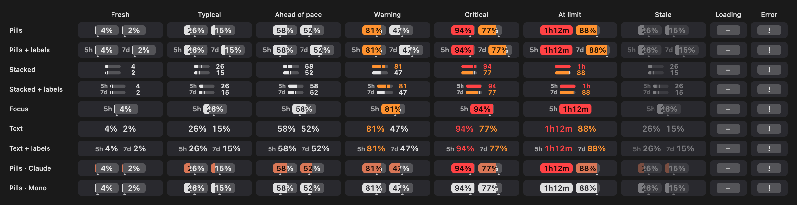
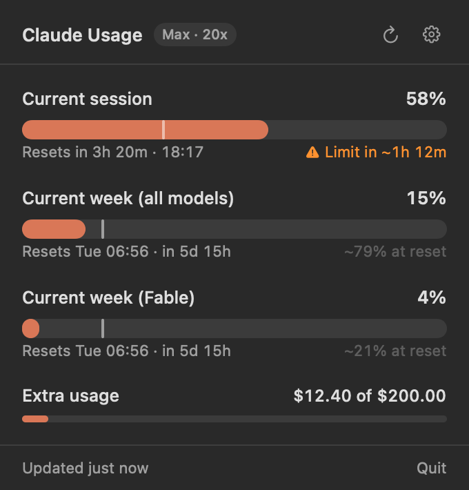
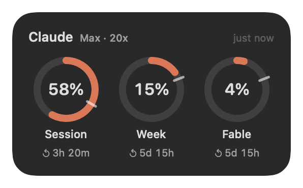
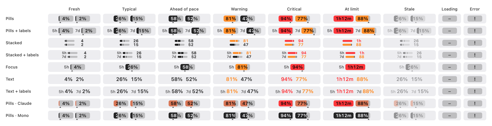
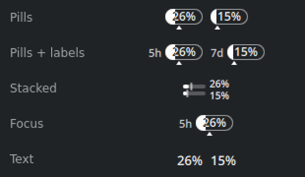
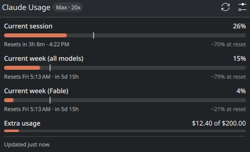
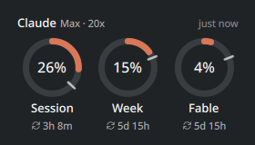

# Claude Usage

Shows your Claude plan limits: the 5-hour session, the weekly cap, and any per-model weekly caps. These are the same numbers `/usage` shows in Claude Code. It comes in two versions with the same features and design:

- **macOS**: a menu bar item and a desktop widget (Swift, in `Sources/`).
- **KDE Plasma 6 on Linux**: a panel widget that also works on the desktop (QML, in [`kde/`](kde/README.md)). See [KDE Plasma](#kde-plasma).



| Popover | Desktop widget |
| --- | --- |
|  |  |

## Install

### macOS

Requires macOS 14+, the Xcode Command Line Tools (`xcode-select --install`), and a Claude Code login (`claude`, then `/login`).

```sh
make install      # builds "Claude Usage.app", copies it to ~/Applications, launches it
```

To build without installing, run `make app`. The app ends up in `build/`.

Don't see it in the menu bar? Menu bar managers such as Hidden Bar, Ice and Bartender put new items in their hidden section. Expand that section and ⌘-drag the item into the visible part. Opening the app again (Spotlight, Finder) always brings up Settings.

### KDE Plasma (Linux)

Requires Plasma 6 and a Claude Code login (`claude`, then `/login`).

```sh
make kde-install  # installs the widget for your user with kpackagetool6
```

Then right-click a panel or the desktop → **Add Widgets…** → **Claude Usage**. More in [KDE Plasma](#kde-plasma) below.

## Using it on macOS

- **Click** the menu bar item for the detail popover: each limit, its reset time, a pace marker, and a forecast ("Limit in ~1h 12m" or "~62% at reset").
- **Right-click** for Refresh, the desktop widget toggle, Settings and Quit.
- **Desktop widget**: turn it on in Settings or from the right-click menu. It sits on the desktop, above the icons and below your windows. Drag it anywhere; right-click it for options, including "Keep Above Other Windows".
- **Terminal**: `ClaudeUsage --print` prints the same table as `/usage`. `--json` gives you the parsed data as JSON.

```
Claude usage  ·  Team · 5x

Current session            █████████░░░░░░░░░░░░░░░   37%   Resets in 3h 49m · 18:39  ⚠ limit in ~1h 59m at this pace
Current week (all models)  ████░░░░░░░░░░░░░░░░░░░░   17%   Resets Tue 06:59 · in 5d 16h  (~90% at reset)
Current week (Fable)       ░░░░░░░░░░░░░░░░░░░░░░░░    0%   Resets Tue 07:00 · in 5d 16h
```

## Menu bar design

Menu bar space is scarce, especially on notched MacBooks, where items that don't fit just disappear. The design started from three questions you want answered at a glance: *how much have I used, am I burning it too fast, and when does it come back?*

**Pills (default), about 80pt for two limits.** Each limit is a small rounded bar with its percentage printed on it, like the battery glyph. The fill knocks the digits out of itself, so the number stays readable wherever the fill edge lands, on a light or dark menu bar. Digits are monospaced and the pill is sized for "88%", so going from 19% to 20% never moves your other menu bar items.

**The pace caret.** The small caret under each pill marks how much of the window has passed. Its position is where your usage would be if you spread it evenly. If the fill is **past the caret**, you're on track to hit the limit before it resets. If it's behind, you have room. The caret takes no extra width, and it sits outside the pill so it never cuts through the digits. An earlier version drew it inside the pill, which made "47%" look like "4|7%".

**Color means something.** In the default *Warnings* mode, pills use the menu bar's own text color and look like any monochrome system item until a limit passes 75% (orange) or 90% (red). *Claude* mode tints them clay. *Mono* never colors them.

**At 100% the pill shows a countdown.** Once you're blocked, the percentage tells you nothing, so the pill turns red and shows the time until reset instead (`1h12m`).

**Stale data fades.** If the last successful fetch is too old (offline, expired login), the item is drawn at reduced opacity instead of showing numbers you shouldn't trust. The popover says why.

Other styles, in Settings → Menu bar style:

| Style | Width | Shows |
| --- | --- | --- |
| Pills | ~80pt | A bar behind each percentage (labels optional: `5h`, `7d`) |
| Stacked | ~50pt | Two mini bars stacked vertically, numbers to the right. The narrowest option. |
| Focus | ~55pt | One pill for whichever limit is closest to running out, with its label |
| Text | ~70pt | Just the numbers, colored the same way |

You choose which limits appear (session, week, per-model weeks). The order always follows the server's: session first, then weekly.

Light menu bar:



## KDE Plasma

The Plasma widget is a port of the macOS app: the same limits, pace marker, forecast, colors and settings, drawn with Plasma's own theme.

| Panel styles | Popup | On the desktop |
| --- | --- | --- |
|  |  |  |

- **In a panel**: the four menu bar styles (Pills, Stacked, Focus, Text). It works in horizontal and vertical panels. **Click** for the detail popup, **middle-click** to refresh, **right-click** for Refresh Now, Open Usage Page and Configure.
- **On the desktop**: one ring per limit, like the macOS desktop widget. Resize and move it like any Plasma widget.
- **Hover** for a tooltip with every limit and its reset time.
- **Settings** (right-click → Configure): style, which limits appear in the panel, labels, pace marker, color mode and refresh interval.

It reads Claude Code's login from `~/.claude/.credentials.json`, where Claude Code keeps it on Linux, and never writes or refreshes it. The last good numbers and the plan name are cached in `~/.cache/plasmashell/claude-usage-widget.conf`. After upgrading, restart Plasma to load the new version (`systemctl --user restart plasma-plasmashell`). `make kde-uninstall` removes it. Details are in [`kde/README.md`](kde/README.md).

## How it works

The same for both versions, except where noted.

- **Data**: `GET https://api.anthropic.com/api/oauth/usage`, the endpoint Claude Code's `/usage` reads. It is undocumented and may change. The plan name ("Ultra", "Pro") comes from `GET /api/oauth/profile`, at most hourly, because the tier Claude Code saves with its login goes stale after a plan change. The parser prefers the structured `limits` array, falls back to the older flat `five_hour`/`seven_day_*` keys, and ignores fields it doesn't recognize.
- **Login (macOS)**: reads Claude Code's OAuth token from the Keychain item `Claude Code-credentials` using `/usr/bin/security`. Claude Code writes that item with the same tool, so reading it doesn't trigger a Keychain prompt. It falls back to `~/.claude/.credentials.json`. The app never writes credentials and never refreshes the token itself. That would rotate Claude Code's refresh token out from under it. On Linux, the KDE widget reads only `~/.claude/.credentials.json` (or `$CLAUDE_CONFIG_DIR/.credentials.json`). If the token has expired, both keep showing the last known numbers (faded) until Claude Code renews it, which happens the next time you use it.
- **Polling**: every 2 minutes by default (configurable), when the popover opens, and after wake. On HTTP 429 it backs off. Only percentages and reset times are cached, in `~/Library/Application Support/ClaudeUsage/snapshot.json` on macOS and `~/.cache/plasmashell/claude-usage-widget.conf` on KDE. Tokens are never written to disk.
- **Reset rollover**: when a window's reset time passes between fetches, it shows 0% right away instead of a stale number.

## Development

```sh
swift build                                    # debug build
swift run ClaudeUsage --print                  # live usage in the terminal
swift run ClaudeUsage --render-previews docs   # regenerate the images in this README
CLAUDE_USAGE_DEBUG=1 "build/Claude Usage.app/Contents/MacOS/ClaudeUsage"   # log fetches and draws
```

| File | What's in it |
| --- | --- |
| `MenuBarRenderer.swift` | All menu bar drawing (Core Graphics). Used by the live item, the Settings tiles and the preview renderer. |
| `UsageParser.swift` | API response → `UsageSnapshot` |
| `Credentials.swift` | Finding Claude Code's login |
| `UsageStore.swift` | Polling, caching, backoff, the clock behind countdowns |
| `StatusItemController.swift`, `PopoverView.swift` | Menu bar item and popover |
| `DesktopWidget.swift` | Desktop panel (Liquid Glass on macOS 26, vibrancy on older versions) |
| `SettingsView.swift` | Settings window |

It's a SwiftPM executable, so you don't need Xcode. `scripts/build-app.sh` wraps the binary in an app bundle, generates the icon, and signs it ad hoc. Set `SIGN_IDENTITY` to sign with a Developer ID.

The KDE widget lives in `kde/package` (a standard Plasma applet package). Its parsing and formatting logic in `kde/package/contents/code/usage.js` mirrors `Models.swift`, `UsageParser.swift` and `Formatting.swift`, so a change to one usually needs the same change in the other. `make kde-test` runs its tests under Node. [`kde/README.md`](kde/README.md) has the file map.

A native WidgetKit widget, the kind in Notification Center and on the desktop since Sonoma, would need an Xcode project, a signed app extension and an App Group. The desktop panel gives you the same view without any of that.

## License

[MIT](LICENSE).
